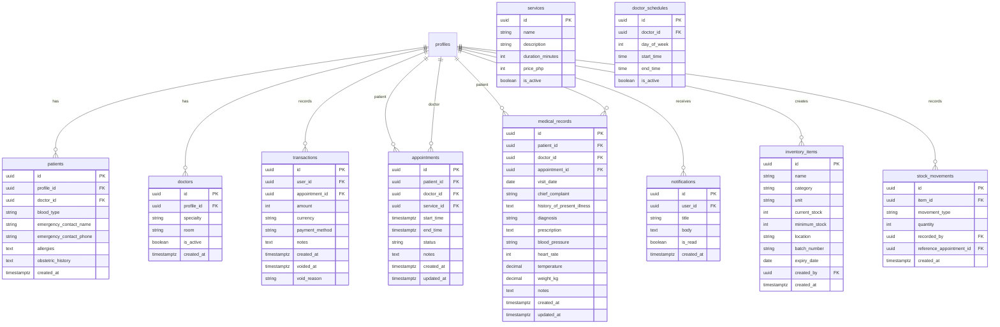
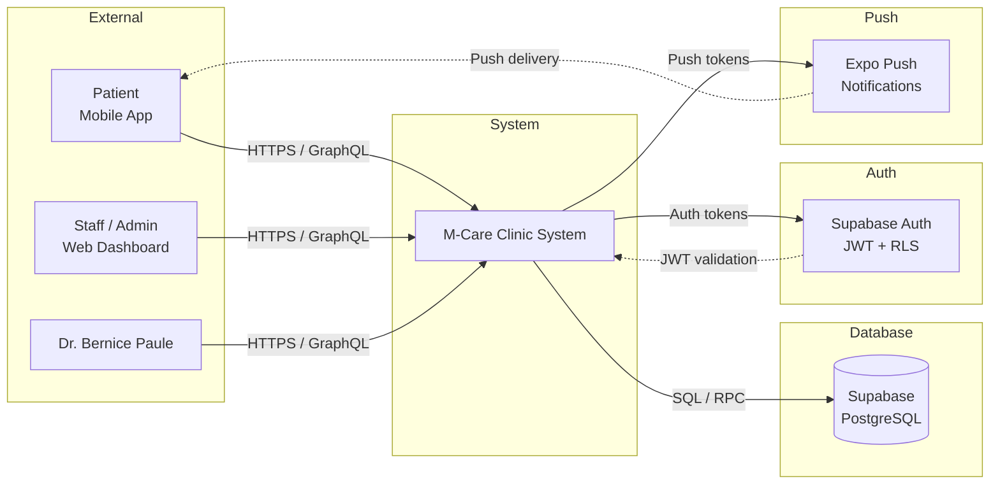

# M-Care Clinic System — Thesis Diagrams

All diagrams use Mermaid syntax. Render with any Mermaid-compatible viewer (GitHub, VS Code, Notion, MkDocs, etc.).

---

## 1. Flowchart — Patient Appointment Booking Flow

```mermaid
flowchart TD
    A[Patient Opens Mobile App] --> B[Select Service]
    B --> C[Select Date\n(Weekdays Only, Asia/Manila)]
    C --> D[Select Available Slot\nvia get_available_slots RPC]
    D --> E[Review Details]
    E --> F[Confirm Booking]
    F --> G{DB: book_appointment RPC}
    G -->|Weekend| H[Reject: Weekends not allowed]
    G -->|Double Book| I[Reject: Slot already taken\nGiST constraint]
    G -->|Success| J[Create appointment\nstatus = 'pending']
    J --> K[Realtime: Push to Staff Dashboard]
    K --> L[Staff: Approve / Decline / Reschedule]
    L -->|Approve| M[status = 'approved']
    L -->|Decline| N[status = 'cancelled']
    L -->|Reschedule| O[status = 'rescheduled'\nnew start_time]
    M --> P[Realtime: Push to Patient App]
    N --> P
    O --> P
    P --> Q[Patient sees updated status]
    Q --> R[Visit Day: Staff marks completed]
    R --> S[status = 'completed']
    S --> T[Staff may record transaction\nfor completed visit]
```

---

## 2. Entity Relationship Diagram (ERD)



---

## 3. Data Flow Diagram — Level 0 (Context Diagram)



---

## 4. Data Flow Diagram — Level 1 (Process Decomposition)

```mermaid
flowchart TD
    subgraph Processes
        P1[Authentication\n& Authorization]
        P2[Appointment\nBooking]
        P3[Appointment\nManagement]
        P4[Medical Records\nManagement]
        P5[Transaction\nRecording]
        P6[Inventory\nManagement]
        P7[Analytics &\nReporting]
        P8[Notification\nDispatch]
    end

    subgraph Data_Stores
        D1[(Patient Data\nprofiles, patients)]
        D2[(Appointment Data\nappointments, schedules)]
        D3[(Clinical Data\nmedical_records)]
        D4[(Financial Data\ntransactions)]
        D5[(Inventory Data\ninventory_items, stock_movements)]
        D6[(Audit Log\naudit_logs)]
        D7[(Notifications\nnotifications)]
    end

    subgraph External_Entities
        E1[Patient Mobile App]
        E2[Staff Web Dashboard]
        E3[Doctor]
        E4[Push Service]
    end

    %% Patient flows
    E1 -->|login / register| P1
    E1 -->|book appointment| P2
    E1 -->|view appointments| P3
    E1 -->|view records| P4
    E1 -->|view transactions| P5
    E1 -->|receive push| P8

    %% Staff flows
    E2 -->|login| P1
    E2 -->|manage patients| P1
    E2 -->|approve/reschedule| P3
    E2 -->|edit records| P4
    E2 -->|record transaction| P5
    E2 -->|manage inventory| P6
    E2 -->|view analytics| P7
    E2 -->|export reports| P7

    %% Doctor flows
    E3 -->|login| P1
    E3 -->|view schedule| P3
    E3 -->|write records| P4

    %% Process to data store
    P1 -->|read/write| D1
    P2 -->|read/write| D2
    P3 -->|read/write| D2
    P3 -->|read| D1
    P4 -->|read/write| D3
    P4 -->|read| D2
    P4 -->|write| D6
    P5 -->|read/write| D4
    P5 -->|read| D2
    P6 -->|read/write| D5
    P6 -->|read| D2
    P7 -->|read| D1
    P7 -->|read| D2
    P7 -->|read| D3
    P7 -->|read| D4
    P7 -->|read| D5
    P8 -->|read/write| D7
    P8 -->|read| D2
    P8 -->|send| E4
```



---

## 5. Use Case Diagram

```mermaid
useCaseDiagram
    actor Patient
    actor "Staff / Receptionist" as Staff
    actor "Doctor / Sonologist" as Doctor
    actor Admin

    package "M-Care Patient Mobile App" {
        UC1[Register / Login]
        UC2[Book Appointment]
        UC3[View Upcoming Appointments]
        UC4[Cancel Appointment]
        UC5[View Medical Records]
        UC6[View Transaction History]
        UC7[Update Profile &\nEmergency Info]
        UC8[Receive Push Notifications]
        UC9[Send Inquiry to Clinic]
    }

    package "M-Care Staff Web Dashboard" {
        UC10[Login / Auth]
        UC11[Manage Patients\n(Search, Register Walk-in)]
        UC12[Approve / Decline Appointments]
        UC13[Reschedule / Cancel Appointments]
        UC14[Calendar Views\n(Day/Week/Month)]
        UC15[View / Edit Medical Records\n(Role-separated fields)]
        UC16[Record Payment Transaction]
        UC17[Void Transaction with Reason]
        UC18[Manage Doctor Schedules]
        UC19[Manage Inventory Items]
        UC20[View Analytics Charts]
        UC21[Export Reports CSV]
    }

    Patient --> UC1
    Patient --> UC2
    Patient --> UC3
    Patient --> UC4
    Patient --> UC5
    Patient --> UC6
    Patient --> UC7
    Patient --> UC8
    Patient --> UC9

    Staff --> UC10
    Staff --> UC11
    Staff --> UC12
    Staff --> UC13
    Staff --> UC14
    Staff --> UC15
    Staff --> UC16
    Staff --> UC17
    Staff --> UC18
    Staff --> UC19
    Staff --> UC20
    Staff --> UC21

    Doctor --> UC10
    Doctor --> UC14
    Doctor --> UC15

    Admin --> UC10
    Admin --> UC11
    Admin --> UC12
    Admin --> UC13
    Admin --> UC14
    Admin --> UC15
    Admin --> UC16
    Admin --> UC17
    Admin --> UC18
    Admin --> UC19
    Admin --> UC20
    Admin --> UC21

    UC2 ..> UC1 : <<include>>
    UC3 ..> UC1 : <<include>>
    UC4 ..> UC1 : <<include>>
    UC5 ..> UC1 : <<include>>
    UC6 ..> UC1 : <<include>>
    UC7 ..> UC1 : <<include>>
    UC9 ..> UC1 : <<include>>

    UC12 ..> UC10 : <<include>>
    UC13 ..> UC10 : <<include>>
    UC14 ..> UC10 : <<include>>
    UC15 ..> UC10 : <<include>>
    UC16 ..> UC10 : <<include>>
    UC17 ..> UC10 : <<include>>
    UC18 ..> UC10 : <<include>>
    UC19 ..> UC10 : <<include>>
    UC20 ..> UC10 : <<include>>
    UC21 ..> UC10 : <<include>>

    UC15 ..> UC12 : <<extend>>\n(doctor writes diagnosis/Rx)
    UC15 ..> UC13 : <<extend>>\n(nurse writes vitals)
```

---

## Notes for Thesis

1. **Flowchart** — Shows the critical path: mobile booking → pending → staff triage → realtime sync → completion → optional transaction record. Weekend and double-booking rejection enforced at database level (GiST constraint + RPC CHECK).

2. **ERD** — Core entities with RLS-policy-relevant foreign keys. `appointments` uses GiST exclusion constraint `no_doctor_double_booking` on `(doctor_id, start_time, end_time) WHERE status IN ('pending','approved','rescheduled')`. `transactions` has CHECK constraint requiring `void_reason` when `voided_at` is set.

3. **DFD Level 0** — Single system boundary with external entities (Patient, Staff, Doctor), Supabase as data store, Supabase Auth as auth boundary, Expo Push as notification channel.

4. **DFD Level 1** — Eight processes matching the feature areas; six data stores; audit log is a write-only store for DPA 2012 compliance (every medical record view logs to `audit_logs` via `log_medical_record_access` RPC).

5. **Use Case** — Role separation: Staff/Receptionist does approval and transaction recording; Doctor writes diagnosis/prescription; Nurse writes vitals; Admin has full access. Patient only reads own data (RLS-enforced). Walk-in patient registration is a Staff use case (creates auth account + patient row via `supabase.auth.signUp`).

---

## Rendering

These diagrams are valid Mermaid. To render:
- **GitHub/GitLab**: View `docs/diagrams.md` directly in the repo
- **VS Code**: Install "Mermaid Preview" extension, open file
- **MkDocs**: Add `markdown.extensions.mermaid2` to config
- **Notion/Obsidian**: Paste the code blocks
- **CLI**: `npx @mermaid-js/mermaid-cli -i docs/diagrams.md -o output/`